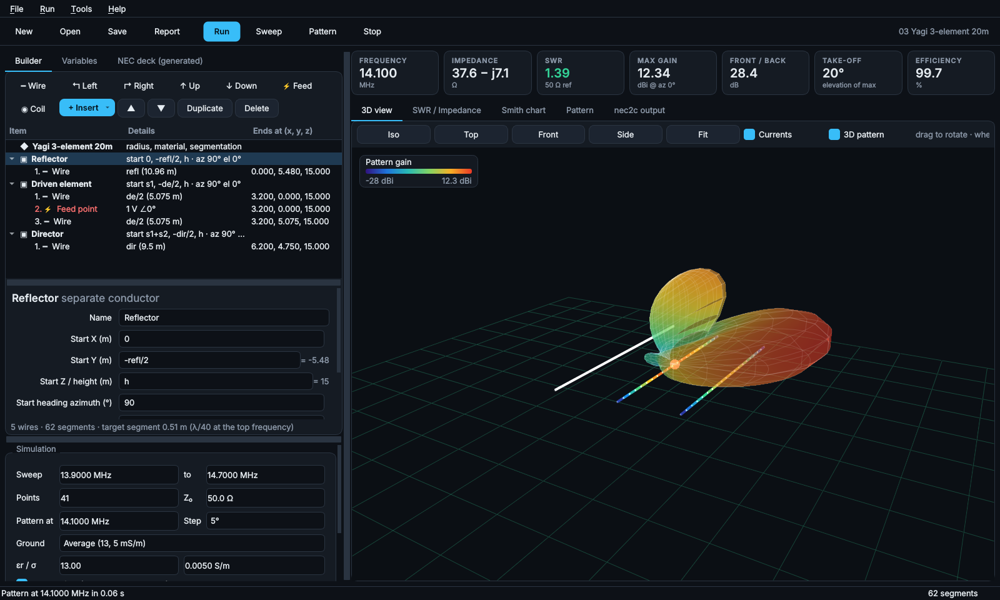
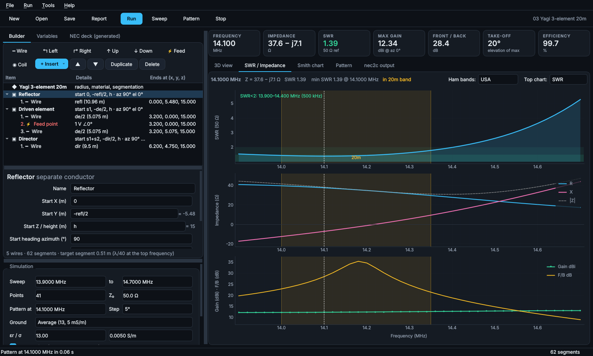
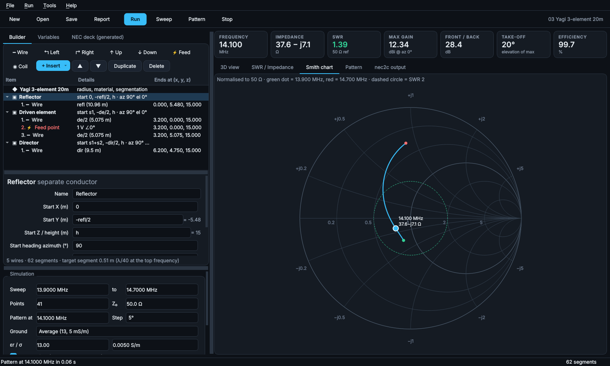
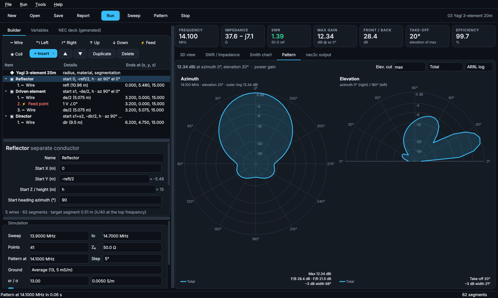

# NEC Next

A modern, cross-platform front end for the **nec2c** antenna simulator, built as a replacement for 4NEC2 on a Raspberry Pi and on Windows.

By KB6JRD · version 0.3 · GPL-3.0-or-later



| SWR with ham bands | Smith chart | Pattern |
|---|---|---|
|  |  |  |

**Download:** get `nec-next-<version>.zip` from the [Releases page](https://github.com/jaredBevis/nec-next/releases), unzip it, and follow the install steps in section 9.

## Contents

1. Quick start
2. Building an antenna
3. Variables and units
4. Running a simulation
5. Reading the results
6. Reports and export
7. Raw NEC decks
8. Keyboard shortcuts
9. Install, uninstall and troubleshooting
10. License

## 1. Quick start

1. Start NEC Next (`run_necnext.bat` on Windows, `./run_necnext.sh` or the menu entry on Linux and the Pi). It opens the 3-element Yagi example.
2. In the **Builder** tab, click any row and change its values in the form underneath. The model re-runs automatically.
3. Look at the tiles across the top (impedance, SWR, gain, F/B, take-off angle, efficiency). Then use the tabs: **3D view**, **SWR / Impedance**, **Smith chart** and **Pattern**.
4. Click the SWR chart to move the marker. The pattern is recomputed at that frequency.
5. **File ▸ Save** stores the design as an `.nnx` file. **File ▸ Report…** (Ctrl+R) makes a printable PDF or HTML report.

To start from scratch, use **File ▸ New**, which gives a simple dipole to edit. The **File ▸ Examples** menu has ten ready-made designs.

## 2. Building an antenna

A design is a list that reads top to bottom, like walking along the wire with a pen.

### Elements

An **element** is one separate conductor, for example a Yagi's reflector, driven element and director, or each radial of a ground plane. Each element has:

| Setting | Meaning |
|---|---|
| Start X, Y, Z (m) | Where the pen starts. Z is the height above ground. |
| Start heading azimuth (°) | 0 = +X, 90 = +Y (counter-clockwise seen from above). |
| Start heading elevation (°) | 0 = horizontal, 90 = straight up, −90 = straight down. |
| Include in the simulation | Untick to leave the element out without deleting it. |

Elements can start at the same point (for example radials starting at a vertical's feed point). Wires that touch are electrically connected.

### Items

Each element holds an ordered list of items:

| Item | What it does |
|---|---|
| **Wire** | A straight conductor of the given length along the current heading. Radius blank = the design's default radius. Segments blank = automatic. |
| **Turn** | Changes the heading. *Left/right* turns about the vertical (positive = left, counter-clockwise from above). *Up/down* tilts the heading (positive = up). Turns are relative to the current heading, so four "Up 90°" turns walk round a vertical square loop. *Point in a direction (absolute)* sets the azimuth and elevation directly. |
| **Gap** | Moves the pen without making a wire. |
| **Helix** | A coil wound along the current heading: turns, diameter, length, wire radius, winding hand and segments per turn. The helix passes through the current point. |
| **Feed point** | A voltage source at this point (voltage and phase). *Transformer* takes a ratio written as feed : antenna. For example, `1:49` is an EFHW transformer and `1:4` a 4:1 balun feeding about 200 Ω. The impedance shown is what the radio sees. |
| **Load** | A lumped part at this point: coil (L with Q), capacitor, resistor, trap (parallel L-C with Q), series L-C, or an impedance R + jX. |
| **Transmission line end** | One end of a line. Two ends with the same *link* name (for example `A`) are joined by a line with the given Z₀, length (0 = straight-line distance) and velocity factor. *Crossed* reverses the connection, as for phasing lines. |

Feeds, loads and line ends sit at the point **between** the items around them. NEC Next puts them on a short segment cut from the neighboring wire, so total lengths stay the same. At a corner, the segment is cut from the longer neighbor, right at the corner.

### Editing the list

- **Insert where you are:** new items go right after the selected row. If an element row is selected, they go at the end of that element. The quick buttons insert a Wire, Left, Right, Up or Down turn, Feed or Coil. **+ Insert** has everything else, including custom and absolute turns, transformer feeds, traps, transmission lines and **New element**.
- **Move:** **▲ ▼** (Ctrl+↑ / Ctrl+↓) move the selected row. A feed point or coil slides along the wire. Items can move into the next or previous element, and whole elements can be reordered.
- **Duplicate** (Ctrl+D) and **Delete** (Del) work on the selected row or element.
- **Turns re-route everything after them.** The *Ends at (x, y, z)* column shows where each item finishes, so you can check corner positions against your yard measurements. The *Random wire around the yard* example shows a wire with turns at the corners.
- **Pick from 3D:** click a wire in the 3D view to select it in the list. The selected item is drawn white in 3D.

### Design settings

Select the top row (the design name) to set the default wire radius, the wire material (perfect, copper, aluminium, brass, steel, stainless or copper-clad steel), segmentation (coarse λ/20, normal λ/40, fine λ/80) and notes for the report.

### Automatic tags and segments

You never enter tag or segment numbers. Segment length is set from the **highest sweep frequency**, with at least about 12 segments per element. Segments next to feeds, loads and short wires are graded, so neighboring segment lengths change gradually, as NEC needs. The line under the list shows the wire count, segment count and target segment length. Warnings appear there too, for example a segment that is too short for its wire radius.

## 3. Variables and units

The **Variables** tab holds named values that any field can use, for example `len/2`, `h+0.5` or `refl*0.95`. Trig functions work in degrees, as in 4NEC2.

- **+ Variable** creates one. The value can be a number or an expression of other variables.
- **Stepping values:** each number variable shows three decimals. Click a digit, or choose it with **◀ ▶**. Then **▲ ▼**, the Up/Down keys or the mouse wheel step that digit: the ones place by 1, the tenths by 0.1, and so on. The model re-runs after each step. You can also type a value.
- **Deleting:** a variable still used anywhere can't be deleted. Its ✕ is grayed out, and clicking it lists every place it is used.

**Units** can be written in any field: `mm cm km in ft` for lengths and `pF nF uF nH uH mH` for parts, for example `12.7mm`, `4.7uH` or `100pF`. Plain numbers are meters, farads, henries, ohms and degrees.

## 4. Running a simulation

The **Simulation** panel under the list controls the runs.

| Setting | Meaning |
|---|---|
| Sweep / to / Points | Frequency range and number of points for the SWR and impedance sweep. The top frequency also sets the segment size. |
| Z₀ | Reference impedance for SWR (normally 50 Ω). |
| Pattern at / Step | Frequency and angular resolution of the far-field pattern. Clicking a chart also sets the frequency. |
| Ground | Free space, perfect ground, real-ground presets (average, poor, good, very good, sandy, sea water…) or custom εr / σ. |
| Sommerfeld | The accurate method for wires near real ground (slower). |
| Gain and F/B vs frequency | Also computes gain and front-to-back at every sweep point. |
| Re-run automatically on edits | Runs after each change. Untick it for large models and press F5 instead. |

**F5** runs the sweep and the pattern, **F7** only the sweep, **F8** only the pattern, and **Esc** stops. nec2c runs in the background, so the window never freezes. Simulation settings are saved in the `.nnx` file.

## 5. Reading the results

- **Tiles:** frequency, feed impedance, SWR (green below 1.5, amber below 2.5), max gain with its direction, front/back, take-off angle and efficiency.
- **3D view:** wires colored by current, the feed (red), loads (amber), transmission lines, the ground plane and a see-through 3D pattern. Drag to rotate and use the wheel to zoom. Iso/Top/Front/Side/Fit set the camera. The *Currents* and *3D pattern* boxes turn layers on and off.
- **SWR / Impedance:** SWR (or return loss), R, X and |Z|, and gain and F/B against frequency. Green shading marks SWR < 1.5 and < 2, with the 2:1 bandwidth shown. **Ham bands** shades the amateur bands for USA (FCC, the default) or IARU Region 1, 2 or 3. The readout says whether the marker is in a band. Click or drag the marker to choose a frequency.
- **Smith chart:** the reflection-coefficient trace with the SWR 2 circle. Click the trace to choose a frequency.
- **Pattern:** azimuth and elevation cuts (ARRL log or linear dB scale), total or total + vertical + horizontal, with F/B, F/R, −3 dB beamwidths and take-off angle. *Elev. cut* sets the elevation of the azimuth plot ("max" follows the main lobe).
- **nec2c output:** the raw nec2c output of the last pattern run.

## 6. Reports and export

- **File ▸ Report…** (Ctrl+R) previews a report and saves it as **PDF** or self-contained **HTML**. It contains:
  - key results and an SWR summary with the 2:1 bandwidth
  - a sweep table
  - the SWR, Smith, pattern and 3D images
  - simulation settings and variables
  - the build list with end coordinates
  - the **finished geometry**: each wire's end points, length, radius and segments, plus the total wire length in meters and feet
  - feeds and loads with their positions
  - the NEC deck
- **File ▸ Export NEC deck** writes the generated deck as a `.nec` file for other NEC programs.
- **File ▸ Export sweep as CSV** and **Export current view as PNG** are also available.

## 7. Raw NEC decks

`.nec` files (plain NEC-2 or 4NEC2 style) open in the **Deck** editor. It has syntax highlighting, card tooltips (hover a card) and live error marking. The **Structure** tab lists every object in the deck and edits it in a form. It can add wires, arcs, helices, feeds, loads, materials, transmission lines, transformers and networks. `SY` lines become variables. **Help ▸ NEC card reference** (Shift+F1) lists the cards.

In raw mode, NEC Next writes the FR, GN, RP and XQ cards from the Simulation panel. Your geometry, EX, LD, TL and NT cards are used exactly as written. The panel is filled in from the file's own FR and GN cards when it opens.

- **Convert to builder:** the banner button (or *File ▸ Convert this deck to a builder design*) turns most wire decks into a builder list. Connected wires become one element with turns, and EX/LD cards become feed points and loads. Unsupported cards are listed before you confirm.
- **Back to a deck:** *File ▸ Edit as a raw NEC deck* switches a design to hand-editing its generated deck.

## 8. Keyboard shortcuts

| Keys | Action |
|---|---|
| Ctrl+N / Ctrl+O / Ctrl+S / Ctrl+Shift+S | New, Open, Save, Save as |
| Ctrl+R | Report |
| F5 / F7 / F8 / Esc | Run all, sweep only, pattern only, stop |
| F1 | This user guide |
| Shift+F1 | NEC card reference |
| Ctrl+↑ / Ctrl+↓ | Move the selected builder row up or down |
| Ctrl+D / Del | Duplicate or delete the selected builder row |
| ↑ / ↓ or wheel (in a variable box) | Step the selected digit |
| Ctrl+Q | Quit |

## 9. Install, uninstall and troubleshooting

### Linux: Raspberry Pi, Debian, Ubuntu, Mint

The Linux scripts work on any apt-based distribution: Raspberry Pi OS Bookworm or later on a Pi 4/5, Debian 12+, Ubuntu 22.04+ and Mint. On other distributions, see *Other Linux / macOS* below.

Everything comes from apt. There is no pip and no compiling.

```sh
./install_linux.sh     # apt installs nec2c, PyQt5, pyqtgraph, numpy, PyOpenGL and adds a menu entry
./run_necnext.sh       # or start "NEC Next" from the menu
./uninstall_linux.sh   # later, to remove it (see below)
```

If the 3D view is blank or slow (for example over VNC), start it with `./run_necnext.sh --no-gl`, or untick OpenGL under *Tools ▸ Settings*.

### Windows 10/11

1. Install Python 3.9+ from python.org and tick *Add to PATH*.
2. Double-click `install_windows.bat`. It creates `.venv` and installs PySide6, pyqtgraph, numpy and PyOpenGL.
3. Double-click `run_necnext.bat`.

A 64-bit **nec2c.exe** is included in `bin\windows\` and found automatically. Its source and the small Windows patch are in `bin\windows\nec2c-src\` (GPL-3.0). If you prefer another build, set its path in *Tools ▸ Settings*.

### Other Linux / macOS

`pip install -r requirements.txt`, install nec2c (`apt install nec2c` / `brew install nec2c`), then `python3 -m necnext [file.nec]`.

### What gets installed where, and how to remove it

NEC Next has no system installer. Apart from the items below, everything lives in the folder you unpacked.

#### Windows

| What | Where | Created by |
|---|---|---|
| App files and the bundled `nec2c.exe` | the `necnext` folder | you (unzip) |
| Python packages (PySide6, pyqtgraph, numpy, PyOpenGL) | `necnext\.venv\` | `install_windows.bat` |
| Settings (window size, recent files, nec2c path) | registry `HKEY_CURRENT_USER\Software\NecNext` | the app, on first run |
| Temporary simulation files | `%TEMP%\necnext_*` | the app; each one is deleted when its run finishes |

Nothing goes into Program Files, PATH, the Start menu or the system Python.

**To uninstall:** delete the `necnext` folder. Optionally also remove the settings key:

```bat
reg delete HKCU\Software\NecNext /f
```

#### Linux (including Raspberry Pi)

| What | Where | Created by |
|---|---|---|
| App files | the `necnext` folder | you (unzip) |
| `nec2c`, `python3-pyqt5`, `python3-pyqtgraph`, `python3-opengl`, `python3-numpy` | system apt packages | `install_linux.sh` (uses sudo) |
| Menu entry | `~/.local/share/applications/necnext.desktop` | `install_linux.sh` |
| Settings | `~/.config/NecNext/` | the app, on first run |
| Temporary simulation files | `/tmp/necnext_*` | the app; each one is deleted when its run finishes |

**To uninstall:** run `./uninstall_linux.sh`. It removes the menu entry and settings, then asks before removing the apt packages, because other programs may use them. `python3-numpy` is always kept, since many programs depend on it. `./uninstall_linux.sh --all` removes the packages without asking. Finally, delete the `necnext` folder.

### Troubleshooting

- **The window doesn't open on Windows:** run `run_necnext_debug.bat`. It keeps a console open, and `necnext_error.log` in the app folder records what happened.
- **The 3D view is blank or slow** (for example over VNC): start with `--no-gl`, or untick OpenGL under *Tools ▸ Settings*.
- **"nec2c was not found":** install it on Linux (`sudo apt install nec2c`), or set its path under *Tools ▸ Settings*.
- **Results look wrong for a very short or thin wire:** check the warnings under the builder list, and try *Fine* segmentation in the design settings.

### Examples

*File ▸ Examples* has builder designs: a 20 m dipole, a 40 m inverted-V, a 3-element 20 m Yagi, a 2 m ground plane, a 20 m quad loop, a 40 m vertical, a coil-loaded short vertical, an end-fed half-wave with a 49:1 transformer, a 70 cm axial-mode helix with a 1:4 transformer, and a random wire routed round the corners of a yard. *Examples ▸ Raw NEC decks* has the first nine as plain `.nec` decks.

### Files

| Extension | Contents |
|---|---|
| `.nnx` | NEC Next design (JSON): elements, items, variables, design and simulation settings. |
| `.nec` | Standard NEC-2 card deck. |

### Source layout

```
necnext/
  builder.py     builder designs: path walking, automatic segmentation, deck generation, .nec import
  deck.py        NEC deck parser, expression evaluator, run-deck builder
  engine.py      runs nec2c and parses its output (geometry, impedance, currents, patterns)
  bands.py       amateur band plans (USA, IARU regions 1-3)
  ui/            Qt interface (PySide6, PyQt6 or PyQt5 through pyqtgraph)
    mainwindow.py  designer.py  editor.py  structure.py  report.py  helpdoc.py
    view3d.py  plots.py  theme.py  compat.py
  examples/      builder designs (.nnx) and sample decks (.nec)
bin/windows/     nec2c.exe and its source
tests/           pytest tests
```

## 10. License

**NEC Next** is © 2026 KB6JRD. It is free software under the **GNU General Public License v3.0 or later** (see `LICENSE`). You may use, study, share and change it. If you distribute it, or a changed version, you must do so under the same license and include the source.

It uses and bundles:

| Component | License |
|---|---|
| nec2c (bundled `nec2c.exe` for Windows, source in `bin/windows/nec2c-src/`) | GPL-3.0 (`bin/windows/NEC2C-COPYING.txt`) |
| Qt for Python: PySide6 (Windows) / PyQt5 (Linux) | LGPL-3.0 / GPL-3.0 |
| pyqtgraph | MIT |
| NumPy | BSD-3-Clause |
| PyOpenGL | BSD-style |

NEC-2 itself was developed at Lawrence Livermore National Laboratory, and nec2c is Neoklis Kyriazis' (5B4AZ) C translation of it. Simulation results are only as good as the model. Check important designs against measurements.

## Not built yet

An optimizer (like 4NEC2's optimizer and sweeper over variables), near-field plots, comparing several models at once, and a one-file Windows build.
